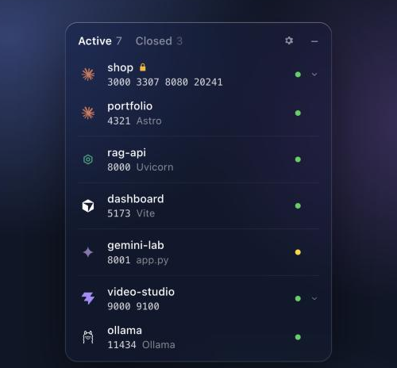
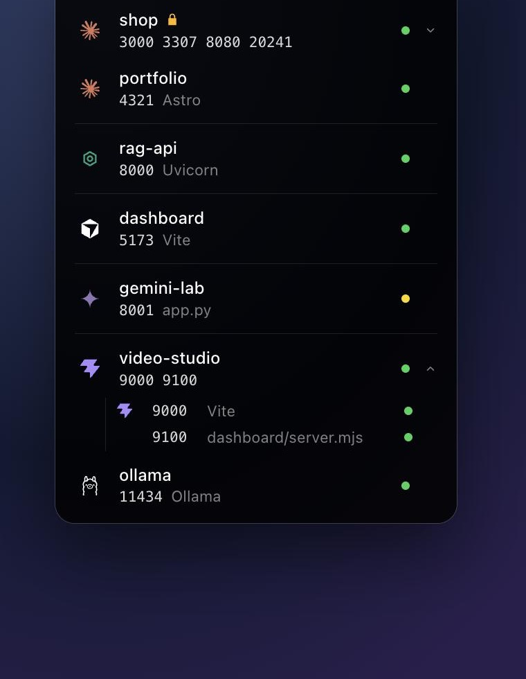
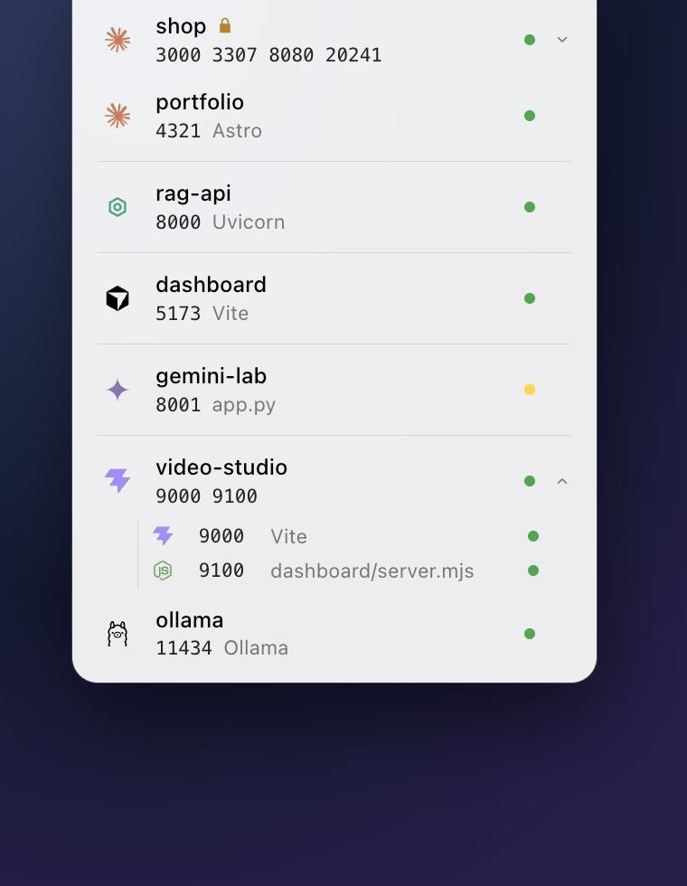
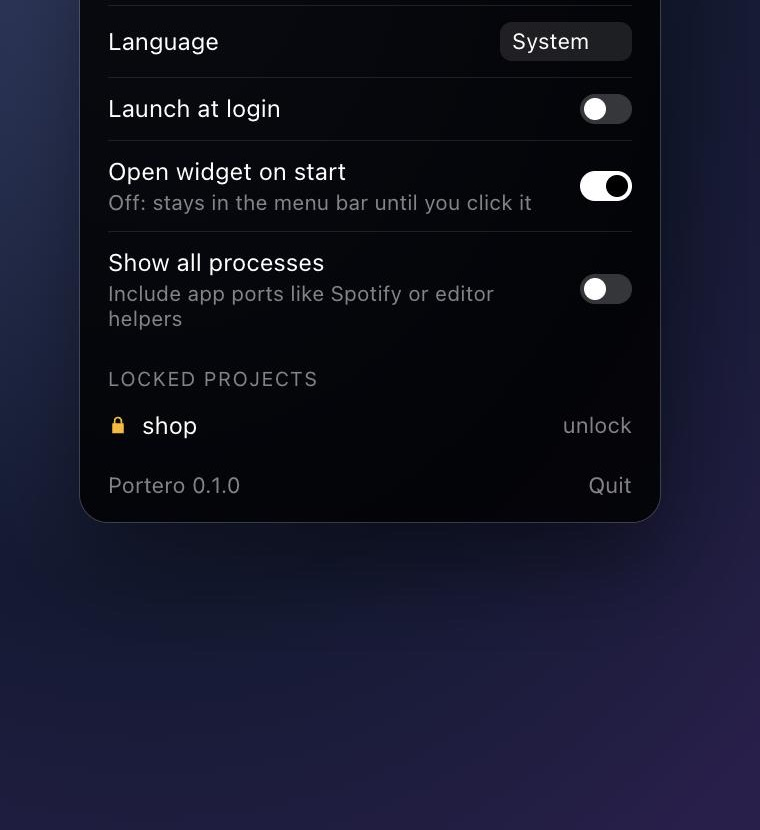

<p align="center">
  
</p>

<h1 align="center">Portkeeper</h1>

<p align="center">
  A tiny desktop widget that answers one question: <b>what is running on my machine right now, who started it, and how do I stop it?</b>
</p>

<p align="center">
  <a href="https://portkeeper.pages.dev">Website</a> ·
  <a href="https://github.com/MarcAparisiTFG/portkeeper/releases/latest">Download</a> ·
  <a href="#what-it-shows">What it shows</a> ·
  <a href="#install">Install</a> ·
  <a href="#build-from-source">Build</a>
</p>

---

## Why

If you work with several projects at once, and let AI coding agents start servers for you, your machine fills up with `localhost:3000`, `:5173`, `:8080`, Docker containers and forgotten dev servers. Finding out which one belongs to which project, which agent opened it, and whether it still answers means `lsof`, `docker ps` and a lot of guessing.

Portkeeper puts that in one small panel in your menu bar (macOS) or system tray (Windows): every project with a listening port, grouped by folder, with the logo of the agent or IDE that started it. Click a port to open it. Stop it with one click. Start it again later. Lock the ones a client depends on so nobody stops them by mistake.

## What it shows

<p align="center">
  
  &nbsp;&nbsp;
  
</p>

- **One row per project.** Processes are grouped by their working directory and merged with the Docker Compose project running from the same folder. A project with several ports expands into one row per port, each with its own label (`Vite`, `dashboard/server.mjs`).
- **Who started it.** The logo is the AI agent or IDE that launched the process, found by walking up the process tree: Claude Code, Codex, Cursor, Gemini CLI, Copilot, Windsurf, VS Code, JetBrains, Zed, Xcode, Cline, Aider, OpenCode. Without one, it shows what serves the port: Docker, Vite, Next, Node, Python, Ollama, Postgres…
- **Does it answer?** The dot is green when the port responds, amber while it is listening but still silent (booting, or hung). Hover it for "Running since…".
- **Sections.** Projects are separated by the agent that started them. Agents first, the rest after.

<p align="center">
  
  &nbsp;&nbsp;
  
</p>

- **Stop.** `■` stops a port or the whole project after a one-button confirmation. Portkeeper asks the process politely first and kills it if it ignores the request for 1.5 s, so Stop always stops.
- **Closed, and start again.** Projects that stopped move to *Closed*. Portkeeper remembers the command that started them (`npm start`, `python -m http.server`, a compose project), the folder and the environment, and `▶` starts them again. Secrets in command lines (`--token`, `API_KEY=`) are masked and never written to disk.
- **Lock.** 🔒 on a project's row hides stop and remove and makes the backend refuse them too. Made for the project a client is testing on your machine.
- **Settings.** Appearance (Liquid Glass on macOS 26, system blur or acrylic elsewhere, or opaque Dark / Light), language (English, Spanish, French, German, Portuguese), launch at login, open on start, show all processes.

Portkeeper works entirely on your machine. It reads the process table and talks to the local `docker` command; the only network traffic is a connection to `localhost` to see whether a port answers.

## Install

Download the file for your system from the [latest release](https://github.com/MarcAparisiTFG/portkeeper/releases/latest):

| System | File |
| --- | --- |
| macOS, Apple Silicon (M1–M4) | `Portkeeper_x.y.z_aarch64.dmg` |
| macOS, Intel | `Portkeeper_x.y.z_x64.dmg` |
| Windows 10 / 11 | `Portkeeper_x.y.z_x64-setup.exe` (or the `.msi`) |
| Linux | `.AppImage`, `.deb` or `.rpm` |

The builds are not code-signed yet, so your system warns you once:

- **macOS:** open the `.dmg`, drag Portkeeper to Applications, right-click it and choose **Open**. If macOS still refuses, run `xattr -dr com.apple.quarantine /Applications/Portkeeper.app`.
- **Windows:** when SmartScreen appears, click **More info**, then **Run anyway**.

Docker features need the `docker` command (Docker Desktop, OrbStack, Colima, Rancher Desktop…). Everything else works without it.

## Use

- Click the menu bar / tray icon to open the widget; `–` or `Esc` tucks it away. Right-click the icon to quit.
- Click a port number to open `http://localhost:PORT`. Click a project with several ports to expand it.
- Hover a row for its actions: lock, stop. In *Closed*: start again, forget.

## Build from source

You need [Rust](https://rustup.rs), Node.js 18+ and the [Tauri prerequisites](https://tauri.app/start/prerequisites/) for your system.

```bash
npm install
npm run dev      # run the app
npm run build    # installers in src-tauri/target/release/bundle/
```

- `src-tauri/` is the Rust side: `ports.rs` (listening sockets, process tree, launch commands), `docker.rs`, `probe.rs` (does the port answer), `launch.rs` (Closed list and relaunch), `settings.rs`, `lib.rs` (tray, window, Liquid Glass, native animations).
- `src/` is a plain HTML, CSS and JS front-end with no bundler. Serve it with `python3 -m http.server -d src 4173` to work on the UI without Rust: `src/mock.js` feeds it sample data.
- `cargo test` in `src-tauri/` runs the unit tests; `cargo test -- --ignored` adds the end-to-end ones that start a throwaway `python3` server, stop it and start it again.
- `portkeeper --dump` prints the raw scan as JSON, useful when reporting a platform-specific bug.

`site/` is the one-page website. `npm run site` copies the app UI into it as a live demo; `npm run deploy:site` publishes it to Cloudflare Pages (run `npx wrangler login` once first).

Releases are built by GitHub Actions when a `v*` tag is pushed. Bump the version in `package.json`, `src-tauri/tauri.conf.json` and `src-tauri/Cargo.toml` first.

## Maintainer


Maintained by **Marc Aparisi Rull**, also behind [Illeta Digital](https://illetadigital.com).<br clear="left" />

[LinkedIn](https://www.linkedin.com/in/marc-aparisi-rull-160bb71bb/) ·
[Instagram](https://www.instagram.com/maparisi_dev/) ·
[YouTube](https://www.youtube.com/@maparisi_dev) ·
[TikTok](https://www.tiktok.com/@maparisi_dev) ·
[Facebook](https://www.facebook.com/profile.php?id=61594776640153) ·
[GitHub](https://github.com/MarcAparisiTFG?tab=repositories)

## License

Free for personal and other noncommercial use under the [PolyForm Noncommercial License 1.0.0](LICENSE.md). **Commercial use needs written permission**: ask on [LinkedIn](https://www.linkedin.com/in/marc-aparisi-rull-160bb71bb/) or open an issue.

Logos come from [Simple Icons](https://simpleicons.org) (CC0) and belong to their respective owners.
